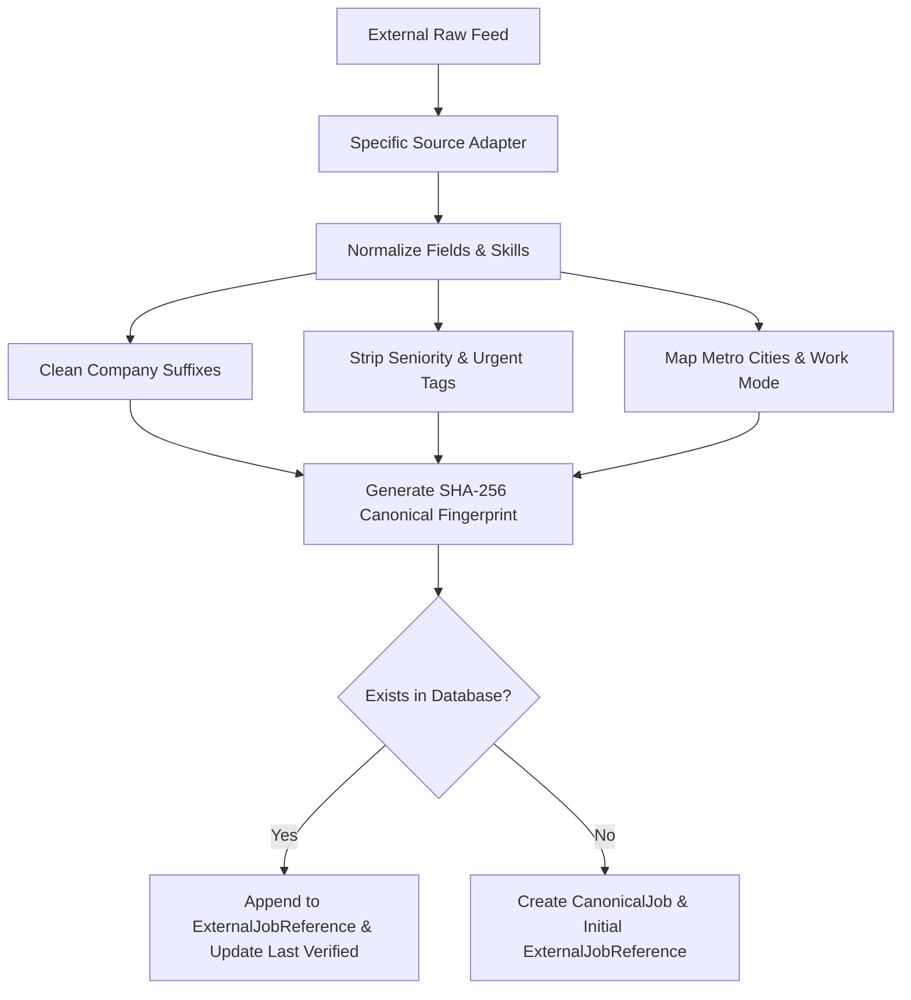

# UNNATI — Job Aggregation, Discovery & Personalised Recommendation System
## External APIs, Data Feeds & Access Requirements Specification

**Document Version:** 1.0.0  
**Classification:** Technical Architecture, Partner Integration & Security Standards  
**Last Updated:** November 2026  
**Module:** `UNNATI Core / External Job Ingestion & Partner Connectors`  

---

## 1. Architectural Strategy & Guiding Principles

The UNNATI Job Aggregation System operates under four non-negotiable principles:

1. **Candidate-First Transparency:** UNNATI is not the hiring employer. Every job card prominently displays the verified primary source (e.g., Naukri, Instahyre, NCS India, Remote OK), the true employer name, and the canonical destination URL.
2. **Deterministic Deduplication:** Jobs cross-posted across multiple commercial boards are merged into a single `CanonicalJob` record with unified skills, salary brackets, and multi-source referral links under `ExternalJobReference`.
3. **Zero Scraping Hallucination:** All ingested data must map to concrete fields. If compensation or experience is undisclosed, the platform explicitly displays "Undisclosed / Competitive" rather than inventing figures.
4. **Strict Gateway Redirection:** Candidates are never subjected to blind redirects or open-redirect vulnerabilities. The gateway validates protocols (`https://` required in production), blocks loopback and private subnets (SSRF protection), and displays the destination domain before opening.

---

## 2. Comprehensive External Source Specifications

### 2.1 Commercial Indian Job Portals

#### 2.1.1 Naukri.com (Info Edge India Ltd)
* **Overview:** India's largest employment marketplace with over 500,000 active postings across technology, finance, engineering, and services.
* **Integration Tier:** Partner API / Verified Enterprise Feed (`Enterprise Connect Tier`).
* **Endpoints:**
  * Base URL: `https://api.naukri.com/v2/jobs`
  * Bulk Ingestion: `GET /v2/partner/feed/jobs?category=it-software&since={timestamp}`
  * Job Verification: `GET /v2/jobs/{external_id}/status`
* **Authentication:** OAuth2 Client Credentials (`client_id`, `client_secret`) with hourly rotating JWT Bearer Token.
* **Rate Limits:** 120 requests/minute, bursting up to 200 requests/minute; maximum 50,000 jobs ingested per 24-hour cycle.
* **Payload Field Mapping:**
  ```json
  {
    "jobId": "naukri-1049281",
    "designation": "Backend Software Engineer - Python",
    "company": { "name": "Swiggy India Pvt Ltd", "website": "https://swiggy.com" },
    "location": { "city": "Bengaluru", "state": "Karnataka", "country": "India" },
    "workMode": "Hybrid",
    "employmentType": "Permanent",
    "experience": { "minYears": 2, "maxYears": 5 },
    "salary": { "min": 1400000, "max": 2200000, "currency": "INR", "period": "ANNUAL" },
    "skills": ["Python", "FastAPI", "PostgreSQL", "Docker", "Redis"],
    "jdHtml": "<h3>About Swiggy</h3><p>We are seeking a Backend Engineer...</p>",
    "applyUrl": "https://www.naukri.com/job-listings-swiggy-python-1049281"
  }
  ```
  * `designation` ➔ `CanonicalJob.title`
  * `company.name` ➔ `CanonicalJob.company_name` (normalized to `swiggy`)
  * `workMode` ➔ `CanonicalJob.workplace_type` (`Hybrid`)
  * `experience` ➔ `CanonicalJob.experience_min_years` / `CanonicalJob.experience_max_years`
  * `salary` ➔ `CanonicalJob.salary_min` / `CanonicalJob.salary_max`
  * `skills` ➔ `CanonicalJob.required_skills`

---

#### 2.1.2 Instahyre
* **Overview:** AI-driven candidate matching platform widely used by top Indian startups, unicorns, and high-growth tech companies.
* **Integration Tier:** Instahyre Partner Webhook & REST Sync API.
* **Endpoints:**
  * Base URL: `https://api.instahyre.com/api/v1`
  * Jobs Stream: `GET /api/v1/opportunities?location=India&status=active`
  * Webhook Ingestion: `POST /api/v1/webhooks/job-events` (Listings created, updated, closed)
* **Authentication:** Token Authentication (`Authorization: Token <INSTAHYRE_API_KEY>`) combined with HMAC SHA-256 webhook signatures.
* **Rate Limits:** 60 requests/minute; webhooks deliver real-time delta updates.
* **Payload Highlights:** Instahyre provides structured skill tags and verified funding stages (e.g. Series C, Unicorn, Bootstrapped), enabling enriched company metadata in UNNATI.

---

#### 2.1.3 Cutshort
* **Overview:** Modern tech hiring network emphasizing direct recruitment with engineering leads and startup founders in India.
* **Integration Tier:** Cutshort Match Partner API.
* **Endpoints:**
  * Base URL: `https://cutshort.io/api/v2`
  * Feed: `GET /api/v2/jobs/public-feed?role=developer&country=India`
* **Authentication:** API Key header (`X-Cutshort-Key: <CUTSHORT_API_KEY>`).
* **Rate Limits:** 100 requests/minute.
* **Deduplication Synergy:** Cutshort postings often match Instahyre postings for identical roles at companies like CRED, Zepto, and Razorpay. UNNATI's canonical hasher merges these seamlessly under one card while retaining both application channels.

---

#### 2.1.4 Freshersworld
* **Overview:** India's premier portal for graduate, entry-level, and fresher hiring across IT and non-IT sectors.
* **Integration Tier:** Freshers RSS & XML Syndication Feed.
* **Endpoints:**
  * Feed URL: `https://www.freshersworld.com/rss/jobs/it-software-jobs.xml`
* **Authentication:** HTTP Basic Authentication / IP Whitelist for syndicated feeds.
* **Rate Limits:** Ingestion executed on a 6-hour cron schedule to prevent unnecessary load.
* **Focus Area:** Powers UNNATI's "Entry-Level Opportunities" filter (`experience_level = 'ENTRY_LEVEL'`, 0–1 years required).

---

### 2.2 Indian Public Sector & Government Employment Exchanges

#### 2.2.1 National Career Service (NCS) — Ministry of Labour & Employment
* **Overview:** The Government of India's official employment exchange portal under the Ministry of Labour & Employment, offering verified vacancies in Central Government departments, state initiatives, and Public Sector Undertakings (PSUs).
* **Integration Tier:** Open Government Data (OGD) Platform / NCS REST Gateway.
* **Endpoints:**
  * Base URL: `https://api.ncs.gov.in/v1`
  * Public Vacancies: `GET /v1/vacancies?state=All&sector=IT`
  * PSU Opportunities: `GET /v1/vacancies/psu?category=Technical`
* **Authentication:** Ministry Gateway API Key (`X-NCS-Auth-Token: <NCS_API_KEY>`) registered under government partner program.
* **Rate Limits:** 30 requests/minute, daily quota of 10,000 queries.
* **Safety & Non-Discrimination:** All NCS listings represent verified government recruitment notices with official notification IDs, reservation criteria transparency, and direct links to official exam portals (e.g., UPSC, SSC, BEL, CDAC).

---

### 2.3 Global & Remote Developer Platforms

#### 2.3.1 Remote OK
* **Overview:** Leading international remote jobs platform featuring opportunities from globally distributed engineering teams.
* **Integration Tier:** Public JSON API / Partner RSS.
* **Endpoints:**
  * Base URL: `https://remoteok.com`
  * Endpoint: `GET /api?tag=software`
* **Authentication:** None required for public endpoint; User-Agent identification required (`User-Agent: UNNATI-CareerPlatform/1.0 (+https://unnati.app)`).
* **Rate Limits:** Maximum 1 request per minute; results are cached locally in UNNATI database for 4 hours.
* **Payload Field Mapping:**
  ```json
  {
    "id": "remoteok-108291",
    "position": "Staff Full Stack Engineer",
    "company": "Gitpod",
    "location": "Worldwide",
    "tags": ["react", "typescript", "golang", "kubernetes"],
    "salary_min": 140000,
    "salary_max": 180000,
    "url": "https://remoteok.com/remote-jobs/remoteok-108291"
  }
  ```
  * `tags` ➔ Normalized into standard canonical skill taxonomy (e.g. `golang` ➔ `Go`, `react` ➔ `React.js`).
  * `salary_min/max` ➔ Expressed in USD, normalized with currency code `USD`.

---

#### 2.3.2 We Work Remotely (WWR)
* **Overview:** One of the world's most established remote work communities.
* **Integration Tier:** RSS / Atom Syndication Feeds.
* **Endpoints:**
  * Engineering Feed: `https://weworkremotely.com/categories/remote-programming-jobs.rss`
  * DevOps / Cloud Feed: `https://weworkremotely.com/categories/remote-devops-sysadmin-jobs.rss`
* **Rate Limits:** 1 request per 30 minutes; parsed using standard XML/Atom RSS parsers.

---

### 2.4 Enterprise Applicant Tracking Systems (ATS) Direct Connectors

#### 2.4.1 Greenhouse & Lever Direct Career Boards
* **Overview:** Top-tier companies (e.g., Uber, Razorpay, PhonePe, Figma) post engineering opportunities directly through enterprise ATS solutions.
* **Integration Tier:** Public ATS Job Board APIs (Harvest / Greenhouse Public API & Lever Postings API).
* **Endpoints:**
  * Greenhouse: `https://boards-api.greenhouse.io/v1/boards/{company_token}/jobs`
  * Lever: `https://api.lever.co/v0/postings/{company_token}`
* **Authentication:** Public GET requests, rate-limited to 50 requests/hour per company board.
* **Advantage:** Guarantees 100% verified employer listings (`is_direct_employer = True`) directly from company career sites without intermediary recruiters.

---

## 3. Data Normalization & Canonical Deduplication Engine

### 3.1 Normalization Pipelines



### 3.2 Canonical Fingerprint Algorithm
To guarantee deterministic deduplication, the platform computes:
$$\text{Canonical Hash} = \text{SHA256}(\text{norm\_company} \parallel \text{"::"} \parallel \text{norm\_title} \parallel \text{"::"} \parallel \text{city} \parallel \text{"::"} \parallel \text{workplace\_type})$$

* Normalization Rules:
  1. **Company:** Convert to lowercase, remove whitespace and corporate suffixes:
     * `Swiggy India Private Limited` $\to$ `swiggy`
     * `Razorpay Software Private Limited` $\to$ `razorpay`
     * `CRED (Dreamplug Technologies)` $\to$ `cred`
  2. **Title:** Convert to lowercase, remove punctuation and recruitment noise:
     * `Senior Full Stack Developer - React / Node (Urgent Hiring!)` $\to$ `senior full stack developer react node`
  3. **Location:** Normalize Indian variations:
     * `Bangalore`, `Bengaluru Urban`, `Blr` $\to$ `Bengaluru`
     * `Gurugram`, `Gurgaon` $\to$ `Gurugram`
     * `Bombay`, `Navi Mumbai` $\to$ `Mumbai`
  4. **Workplace Type:** Constrained to enum: `Remote`, `Hybrid`, `Onsite`.

---

## 4. Security, SSRF Prevention & Safe Gateway Specification

### 4.1 Vulnerability Threat Model
Direct links ingested from external feeds pose serious security risks:
* **Server-Side Request Forgery (SSRF):** Attacker injects internal network URLs (e.g. `http://169.254.169.254/latest/meta-data/` or `http://localhost:8000/admin`).
* **Cross-Site Scripting (XSS):** Malicious URL payloads containing `javascript:` or `data:` URIs.
* **Phishing & Brand Impersonation:** Fake recruiter links mimicking genuine brands to harvest candidate credentials.

### 4.2 Gateway Protection Matrix
All external redirects must pass through `POST /api/v1/jobs/{job_id}/apply`:

```python
# Validation Rules
1. Allowed Protocols: Scheme must strictly equal 'http' or 'https'. Rejects all other protocols.
2. Hostname Validation: Destination host cannot be empty, must contain valid DNS syntax.
3. Private IP & Loopback Filter:
   - 127.0.0.0/8 (Loopback / Localhost)
   - 10.0.0.0/8, 172.16.0.0/12, 192.168.0.0/16 (Private IPv4)
   - 169.254.0.0/16 (Cloud Link-Local / Metadata)
   - ::1 and fc00::/7 (IPv6 Loopback and Unique Local)
4. Domain Attribution: Gateway outputs 'destination_domain' and 'is_trusted_domain' flag.
5. Window Opening: Web client enforces window.open(url, '_blank', 'noopener,noreferrer').
```

### 4.3 Telemetry & Ethical Application Tracking
* When a candidate clicks "Apply on [Portal]", the platform records `JobApplicationActivity` with `status = LINK_OPENED`.
* The platform **never claims** that the application has been submitted to the employer.
* The UI clearly prompts the candidate: *"Once you have completed your application on [Portal], update your status to Applied to track your interview pipeline."*

---

## 5. Environment Variables & Operational Configuration

The following configuration parameters must be set in `.env` / production deployment secrets:

```bash
# ==============================================================================
# UNNATI JOB DISCOVERY & EXTERNAL INGESTION CONFIGURATION
# ==============================================================================

# Commercial Indian Partner Feeds
NAUKRI_API_ENABLED=true
NAUKRI_API_KEY="naukri_partner_sec_live_..."
NAUKRI_CLIENT_ID="unnati_partner_client"
INSTAHYRE_API_KEY="instahyre_sec_live_..."
CUTSHORT_API_KEY="cutshort_sec_live_..."
FRESHERSWORLD_FEED_URL="https://www.freshersworld.com/rss/jobs/it-software-jobs.xml"

# Indian Government Public Exchanges
NCS_GOV_API_KEY="ncs_gov_in_api_token_..."
NCS_SYNC_INTERVAL_HOURS=12

# Global & Remote Job Feeds
REMOTEOK_API_URL="https://remoteok.com/api"
REMOTEOK_CACHE_MINUTES=240
WWR_FEED_URL="https://weworkremotely.com/categories/remote-programming-jobs.rss"

# Redirection & Security Controls
JOB_REDIRECT_STRICT_HOST_CHECK=true
JOB_REDIRECT_ALLOWED_DOMAINS="naukri.com,instahyre.com,cutshort.io,freshersworld.com,ncs.gov.in,remoteok.com,weworkremotely.com,greenhouse.io,lever.co,myworkdayjobs.com"
JOB_REDIRECT_BLOCK_PRIVATE_IPS=true

# Sync Scheduler & Worker Limits
JOB_SYNC_BATCH_SIZE=100
JOB_SYNC_TIMEOUT_SECONDS=45
JOB_EXPIRATION_DAYS=45
```

---

## 6. Maintenance, Dead Link Detection & Purge Strategy

1. **Dead Link Detection:** External job reference links are verified every 7 days via lightweight HTTP `HEAD` requests. If an external URL returns `HTTP 404`, `HTTP 410`, or redirects to an expired banner, its reference status is marked `EXPIRED`.
2. **Canonical Job Auto-Archival:** If all external references for a canonical job become expired, or if more than 45 days have elapsed without verification, `CanonicalJob.status` transitions from `ACTIVE` to `ARCHIVED`.
3. **Candidate Saved Pipeline Retention:** Saved jobs and tracked applications are never permanently deleted from candidate pipelines, ensuring users retain a complete historical record of their interview journey.

