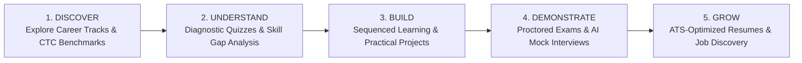
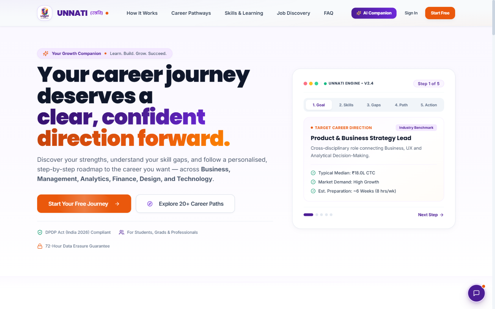
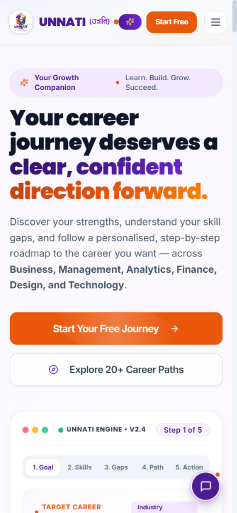
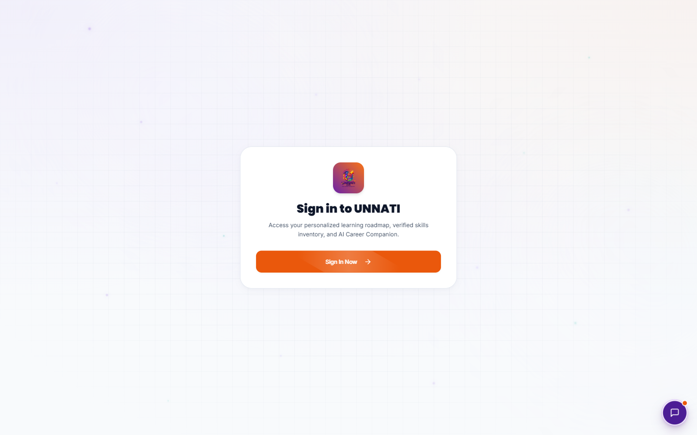
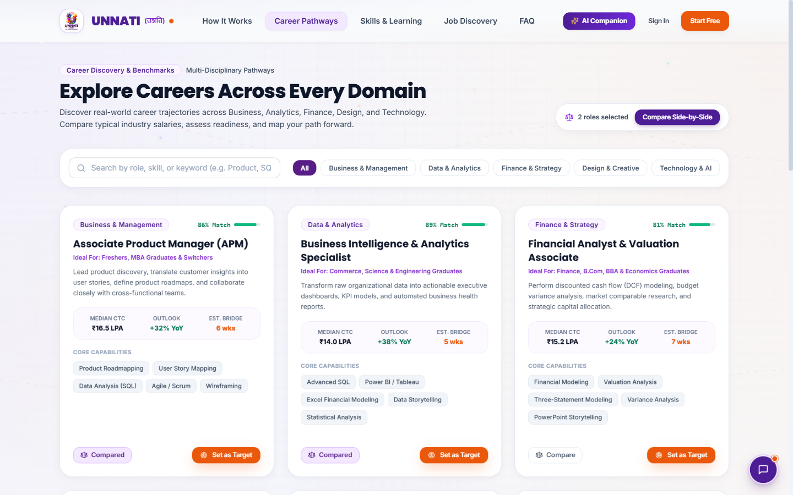
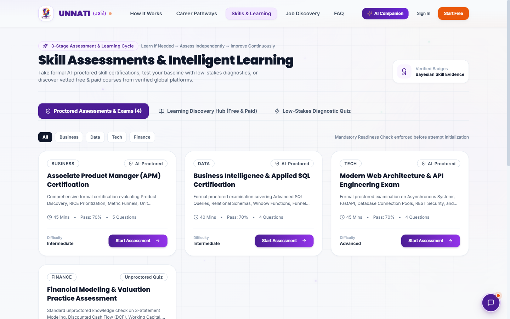
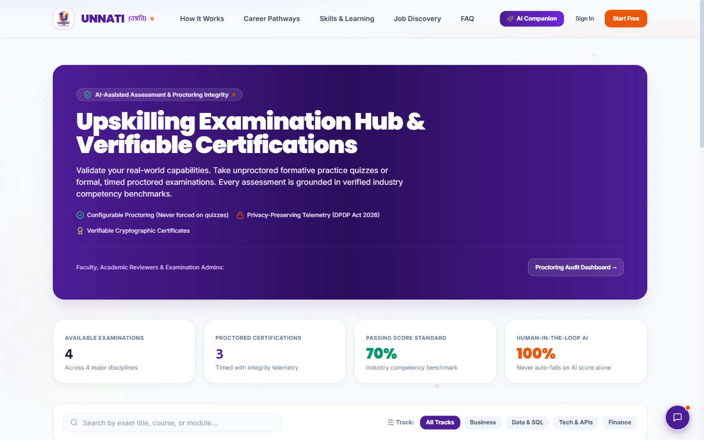
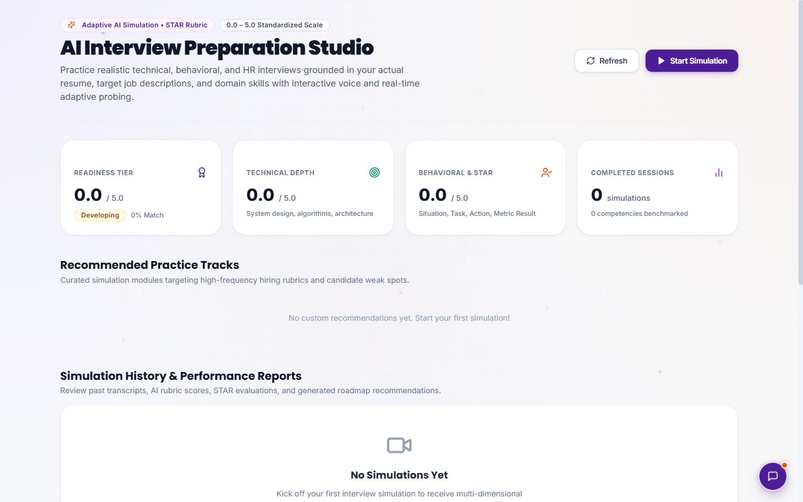
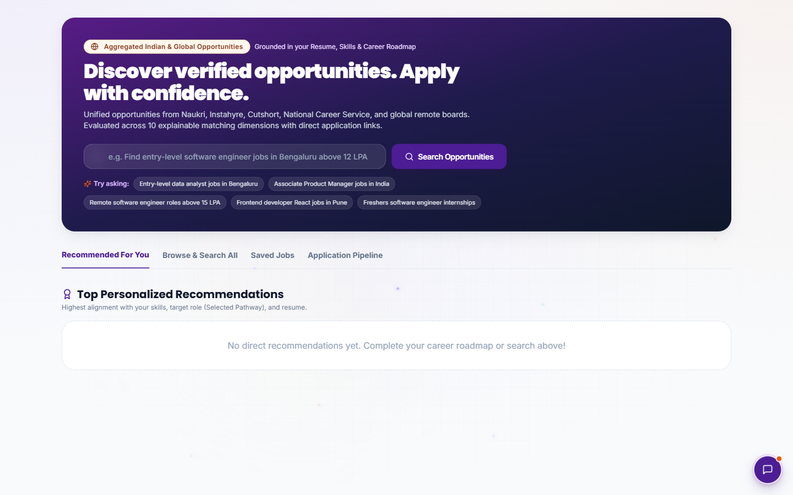
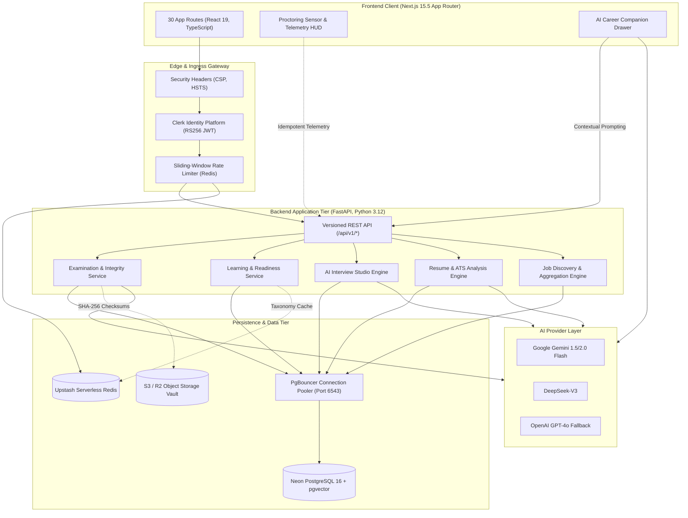

# UNNATI (उन्नति) — Your Growth Companion

<p align="center">
  
</p>

<p align="center">
  <strong>Learn. Build. Grow. Succeed.</strong><br />
  <em>The Integrated AI-Powered Career Intelligence, Realistic Interview Simulation & Proctored Assessment Ecosystem</em>
</p>

<p align="center">
  <a href="#core-features">Features</a> •
  <a href="#application-screenshots">Screenshots</a> •
  <a href="#system-architecture">Architecture</a> •
  <a href="#tech-stack">Tech Stack</a> •
  <a href="#installation--setup">Quick Start</a> •
  <a href="#security--privacy-dpdp-act-2026">Security & Privacy</a> •
  <a href="#documentation">Documentation</a>
</p>

---

## 1. Project Identity & Meaning

**UNNATI (उन्नति)** is derived from the ancient Sanskrit word signifying *elevation, upward progress, advancement, and holistic growth*. 

In modern professional and academic landscapes, career progression is rarely linear. Learners face fragmented guidance, disconnected learning courses, opaque ATS hiring algorithms, stressful interview formats, and credential verification deficits. 

**UNNATI — Your Growth Companion** transforms this broken journey into an integrated, transparent, and personalized career ecosystem. It acts as an intelligent mentor, evaluator, and career strategist for students, early-career professionals, institutions, and recruiting organizations.

---

## 2. Problem Statement & The UNNATI Solution

| Challenge in Traditional Career Tech | How UNNATI Solves It |
| :--- | :--- |
| **Fragmented Career Guidance**: Isolated tools for resume writing, mock interviews, and job hunting without feedback loops. | **Unified Lifecycle**: Continuous progress loop connecting skill diagnostics, tailored learning, verified credentials, and matched jobs. |
| **Hidden Skill Gaps**: Job seekers do not know why resumes fail ATS screens or what exact competencies they lack. | **Semantic ATS & Gap Engine**: Real-time keyword density, quantifiable impact metrics, and vector similarity matching against target Job Descriptions. |
| **Course Overload & Disconnected Upskilling**: Hundreds of hours spent on random tutorials without practical application. | **Sequenced Pathways**: Curated free and paid learning pathways (Coursera, Udemy, NPTEL, edX) mapped to concrete roadmap milestones. |
| **Lack of Credible Skill Evidence**: Certificates often lack proof of authenticity or integrity verification. | **AI-Proctored Assessments**: Low-stress, explainable proctoring with cryptographic SHA-256 evidence hashing and public verification portals. |
| **Stressful & Generic Interview Prep**: Standard flashcards that do not evaluate actual STAR responses or role depth. | **Realistic AI Interview Studio**: Dynamic verbal/text interview turns derived directly from the candidate's resume and target JD. |
| **Scattered Job Hunting**: Inefficient search across multiple job boards with no alignment to actual verified skills. | **Intelligent Job Aggregator**: Unified discovery across Indian and global markets with match percentage badges and application trackers. |

---

## 3. The Core Product Journey

The UNNATI ecosystem guides every learner through five deliberate, interconnected phases:



1. **Discover**: Uncover multi-disciplinary career paths (Software Engineering, Data Science & AI, Business Management, Finance) with transparent market compensation data and growth trends.
2. **Understand**: Benchmark current proficiency through low-stakes diagnostic quizzes and identify precise skill gaps before investing study time.
3. **Build**: Master core competencies through structured 4-stage learning pathways integrating vetted free and paid courses.
4. **Demonstrate**: Validate domain competence through server-authoritative, AI-proctored formal assessments and realistic mock interviews evaluated against STAR rubrics.
5. **Grow**: Export verified cryptographic credentials, optimize resumes against target JDs, and discover matching opportunities across Indian and global job markets.

---

## 4. Comprehensive Feature Overview

UNNATI incorporates eighteen (18) deeply integrated functional modules:

1. **Authentication & Profile Management**: Multi-session authentication via Clerk (Google, GitHub, Email) with academic and work history profiles.
2. **Resume Intelligence & Parser**: Automated PDF/DOCX text extraction, section breakdown, and skill entity tagging.
3. **ATS Optimization & Checker**: Formatting analysis, keyword density calculation, quantifiable impact scoring, and improvement suggestions.
4. **Job Description Semantic Matching**: Vector embeddings and cosine similarity benchmarking resumes against live job descriptions.
5. **Career Explorer & Market Intelligence**: Salary ranges (₹ LPA / $ USD), YoY growth rates, core skills, and day-in-the-life overviews for 7+ benchmark roles.
6. **Skills Inventory Ledger**: Unified skill dashboard categorized across 5 verification tiers (*Certified*, *Diagnostic Verified*, *Resume Inferred*, *Self-Reported*).
7. **Personalized Career Roadmap**: Algorithmic milestone synthesis generating sprint-based learning plans.
8. **Curated Learning Hub**: Searchable directory of 15+ curated free and paid courses across Coursera, Udemy, NPTEL, edX, and YouTube.
9. **Assessment Readiness Gate**: Three-option decision gate (*Option A: Direct Exam*, *Option B: Guided Learning*, *Option C: Diagnostic Quiz*).
10. **AI-Proctored Examination Engine**: Multi-disciplinary assessment taking room with server-authoritative timers, autosave, and question randomization.
11. **Telemetry & Integrity Proctoring**: Privacy-preserving focus detection (tab switch, blur, audio spikes, face presence) with idempotent `client_event_id` transmission.
12. **Cryptographic Certificate Verification**: Tamper-proof certificate generation with SHA-256 verification hashes and instant public lookup routes.
13. **AI Career Companion**: Persistent slide-over conversational mentor providing real-time upskilling guidance with prompt injection guardrails.
14. **AI Interview Studio**: Turn-by-turn mock interview simulation supporting Technical, Behavioral, and System Design modes.
15. **Interview Performance Scorecard**: Diagnostic reporting evaluating technical depth, communication clarity, and STAR framework adherence.
16. **Global Job Discovery & Aggregation**: Multi-filter job search across Indian and international locations with direct application links.
17. **Application Tracker**: Kanban and list trackers monitoring job applications (*Saved*, *Applied*, *Interviewing*, *Offered*).
18. **Administrative & Proctor Review Portal**: Secure review queue for proctors to audit flagged sessions, inspect event telemetry, and record final verdicts.

---

## 5. Application Screenshots

### Public Experience & Brand Identity
| Desktop Homepage Hero | Responsive Mobile Homepage |
| :---: | :---: |
|  |  |

### Actionable Dashboard & Career Exploration
| Actionable Command Center | Career Explorer & Benchmarks |
| :---: | :---: |
|  |  |

### Learning, Assessments & Proctored Integrity
| Curated Learning Hub | Proctored Examination Catalog |
| :---: | :---: |
|  |  |

### AI Interview Simulation & Global Job Discovery
| AI Interview Studio | Global Job Discovery |
| :---: | :---: |
|  |  |

*Full screenshot inventory and viewport specifications are indexed in [`screenshots/SCREENSHOT_INDEX.md`](screenshots/SCREENSHOT_INDEX.md).*

---

## 6. System Architecture



---

## 7. Technology Stack

### Frontend Client (`apps/web`)
- **Framework**: Next.js 15.5 (React 19, App Router architecture).
- **Language**: TypeScript 5.8 (Strict typing, zero compiler errors).
- **Styling**: Tailwind CSS v3.4 with custom enterprise design tokens.
- **Icons & Primitives**: Lucide React, Radix UI.
- **Authentication**: `@clerk/nextjs` (v7.9).

### Backend API Service (`apps/api`)
- **Framework**: FastAPI (Python 3.12) with asynchronous ASGI concurrency.
- **Data Validation**: Pydantic v2 (Strict schemas, `ConfigDict(from_attributes=True)`).
- **ORM**: SQLAlchemy 2.0 (Declarative Base, Mapped type annotations).
- **Database Driver**: `psycopg` (v3).

### Database, Cache & Storage
- **Primary Database**: PostgreSQL 16 hosted on Neon Serverless with `pgvector`.
- **Connection Architecture**: Three-identity pooling (`unnati_owner`, `unnati_api`, `unnati_ro`).
- **Cache & Rate Limiting**: Upstash Serverless Redis (`rediss://` TLS).
- **Object Storage**: S3-compatible cloud bucket for proctoring evidence and documents.

### AI Engine Integrations
- **Primary LLM**: Google Gemini 1.5/2.0 Flash (official `google-genai` SDK).
- **Specialized Code Prompts**: DeepSeek-V3.
- **Fallback Completions**: OpenAI GPT-4o.

---

## 8. Security & Privacy (DPDP Act, India 2026)

UNNATI enforces privacy-by-design standards in strict alignment with India's **Digital Personal Data Protection Act (2026)** and **OWASP API Security Top 10**:

1. **Informed Consent**: Proctored examinations strictly require explicit opt-in; the exact UTC timestamp is permanently logged.
2. **Zero Continuous Raw Video/Audio Retention**: The system captures structured behavioral events (`TAB_SWITCH`, `AUDIO_SPIKE`, `FACE_ABSENCE`) rather than streaming or storing uncompressed candidate video.
3. **Cryptographic Checksums**: Snapshot frames compute a SHA-256 hash stored directly in `proctoring_evidence.checksum_sha256` to detect tampering.
4. **Automated 90-Day Retention TTL**: Telemetry records expire automatically after 90 days, guaranteeing purpose limitation.
5. **Asymmetric Token Verification**: Clerk RS256 JWT tokens verified against public JWKS with clock-skew bounds.
6. **Strict RBAC & Object Isolation**: Database queries enforce candidate ownership (`user_id == user.id`); cross-user telemetry access is strictly rejected with **HTTP 403 Forbidden**.
7. **Enterprise Security Headers**: Next.js injects strict CSP, HSTS (`max-age=63072000; preload`), Frameguard (`SAMEORIGIN`), and Permissions-Policy (`camera=(self), microphone=(self)`).

---

## 9. Installation & Setup

### Prerequisites
- Node.js 20.x+ and `pnpm` (v9+)
- Python 3.12+
- Neon PostgreSQL database instance (or local PostgreSQL)
- Upstash Redis instance (optional for local dev; in-memory fallback active)

### 1. Clone the Repository
```bash
git clone https://github.com/parth022002/UNNATI---Connect-learning-capability-and-opportunity..git
cd "UNNATI Code"
```

### 2. Configure Environment Variables
Copy `.env.example` into both backend and frontend applications:
```bash
# Backend configuration
cp .env.example apps/api/.env

# Frontend configuration
cp .env.example apps/web/.env.local
```
*(Refer to [`docs/CONFIGURATION.md`](docs/CONFIGURATION.md) for full descriptions of all variables).*

### 3. Backend Setup & Local Server
```bash
cd apps/api

# Create and activate Python virtual environment
python -m venv .venv
source .venv/bin/activate  # On Windows: .venv\Scripts\Activate.ps1

# Install dependencies
pip install -r requirements.txt

# Run database migrations
alembic upgrade head

# Start FastAPI server
uvicorn app.main:app --host 127.0.0.1 --port 8000 --reload
```
*API docs available at: `http://127.0.0.1:8000/docs`*

### 4. Frontend Setup & Local Client
```bash
cd apps/web

# Install pnpm dependencies
pnpm install

# Start Next.js development server
pnpm run dev
```
*Web application live at: `http://localhost:3000`*

---

## 10. Automated Testing & Quality Assurance

### Run Backend Pytest Suite (65 Tests)
```bash
cd apps/api
.venv/bin/pytest tests/ -v
# On Windows: .venv\Scripts\python -m pytest tests/ -v
```
*Result: 65 / 65 passed (100% pass rate).*

### Run Frontend Typecheck & Production Build
```bash
cd apps/web

# TypeScript validation
pnpm run typecheck

# Production build verification (30 routes compiled)
pnpm run build
```
*Result: Zero errors, zero build warnings.*

---

## 11. Permanent Documentation Index

Detailed technical, architectural, and operational documentation is consolidated in the [`docs/`](docs/) directory:

- **[`docs/ARCHITECTURE.md`](docs/ARCHITECTURE.md)**: Deep architectural patterns, sequence diagrams, and cross-cutting concerns.
- **[`docs/DATABASE.md`](docs/DATABASE.md)**: Database schemas, pgvector indexing, connection pools, and SQLite compatibility.
- **[`docs/API.md`](docs/API.md)**: Complete REST API documentation across all 10 router domains.
- **[`docs/SECURITY.md`](docs/SECURITY.md)**: Security specifications, DPDP Act 2026 compliance, and cryptographic hashing.
- **[`docs/DEPLOYMENT.md`](docs/DEPLOYMENT.md)**: Production deployment instructions for Vercel, Render, and Neon.
- **[`docs/CONFIGURATION.md`](docs/CONFIGURATION.md)**: Detailed environment variable directory and secret rotation guide.
- **[`screenshots/SCREENSHOT_INDEX.md`](screenshots/SCREENSHOT_INDEX.md)**: Comprehensive index of all application screenshots.

---

## 12. Authorship & Attribution

**Designed & Developed with excellence by Parth Ahuja.**  
*UNNATI — Your Growth Companion (उन्नति).*  
*Copyright © 2026. All rights reserved.*
