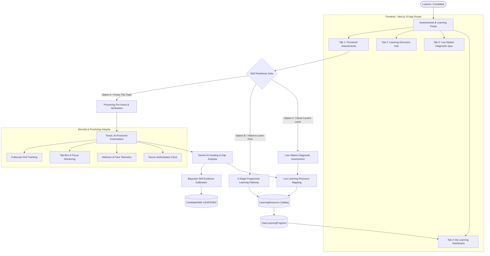
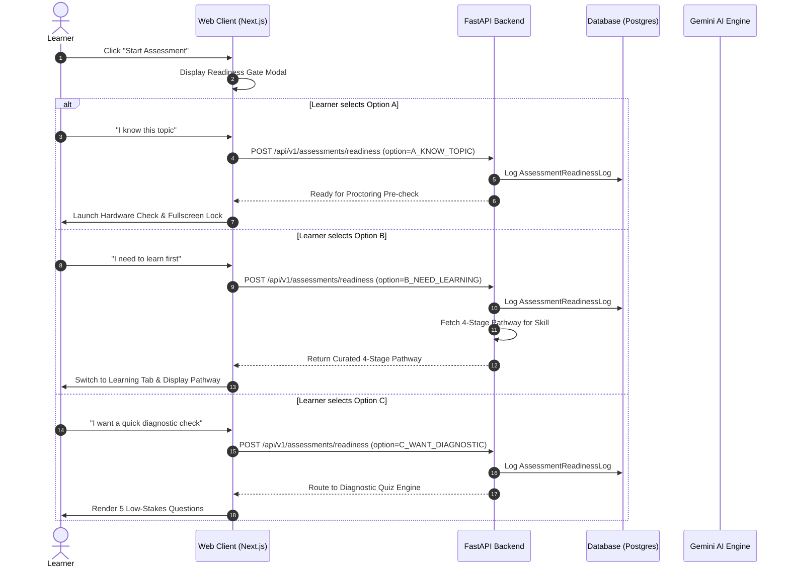
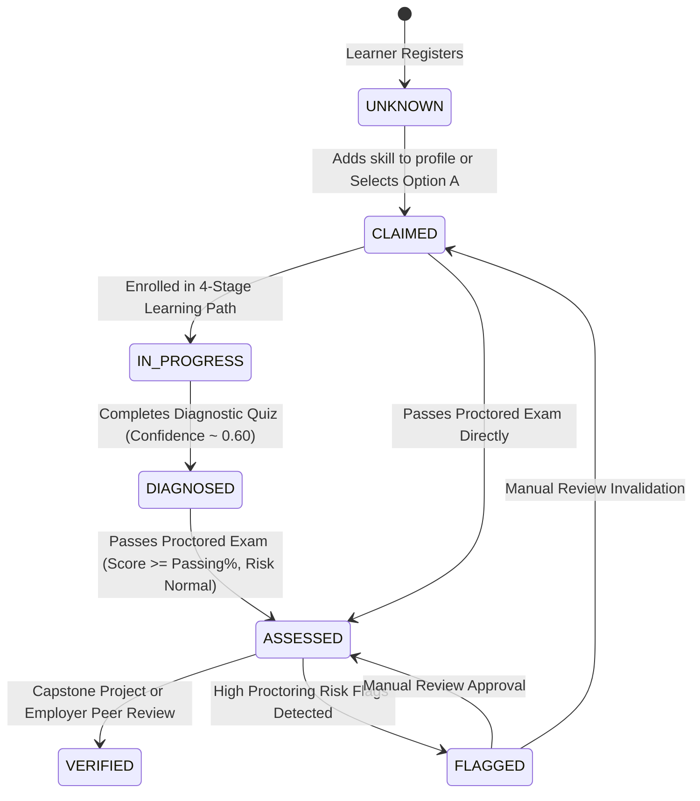

# UNNATI — AI-Proctored Skill Assessment & Intelligent Learning Recommendation System
## Complete Technical Architecture & System Design Specification

**Document Version:** 1.0.0  
**Status:** **PRODUCTION ARCHITECTURE SPECIFICATION**  
**Subsystems:** `apps/api` (FastAPI / SQLAlchemy), `apps/web` (Next.js 15 App Router / TailwindCSS / Lucide), Google Gemini AI  

---

## 1. High-Level Architectural Overview

The **UNNATI Assessment & Learning Ecosystem** provides a closed-loop skill verification and continuous upskilling pipeline. It bridges the gap between self-declared candidate competence and verifiable, proctored industry capability, while providing actionable, sequential learning pathways to close identified competency blind spots.



---

## 2. The 3-Stage Assessment & Upskilling Lifecycle

### Stage 1: Pre-Assessment Readiness Gate
Before any learner can enter a formal examination, they must pass through the **Readiness Gate**. This prevents anxiety, reduces abandonment rates, and avoids unwarranted failures from premature examination attempts.

1. **Option A: "I know this topic — test my skills directly"**
   - Learner declares current competence.
   - System verifies prerequisites and past attempts.
   - Learner is directed to the **System Hardware & Camera Pre-check**.
   - Note: Self-declaration alone **never** elevates skill evidence beyond `CLAIMED`.
2. **Option B: "I need to learn this topic first — show me learning paths"**
   - System retrieves the 4-stage sequential learning pathway for the specific skill.
   - Automatically enrolls the learner in Stage 1 and bookmarks the sequence in their dashboard.
3. **Option C: "I want to understand my current level first — give me a quick quiz"**
   - System generates a 5-minute, low-stakes diagnostic quiz (5 questions).
   - No proctoring cameras or strict fullscreen enforcement.
   - Provides immediate diagnostic feedback and recommended entry level.



---

### Stage 2: AI-Proctored Examination & Telemetry Engine
The proctoring engine operates on a zero-trust, privacy-first telemetry architecture:

```mermaid
graph LR
    subgraph Browser Sensors
        W[Webcam Feed] --> MD[Client Face Detection]
        M[Microphone] --> AD[Client Audio Analyser]
        D[DOM Listeners] --> FS[Fullscreen / Visibility Change]
    end
    
    subgraph Telemetry Dispatcher
        MD -->|Metadata only| Batch[Event Aggregator]
        AD -->|Metadata only| Batch
        FS -->|Violation data| Batch
    end
    
    subgraph FastAPI Backend
        Batch -->|HTTP POST| Ep[/attempts/{id}/proctoring-events]
        Ep --> DB[(ExamProctoringEvent)]
        Ep --> Val[Risk Analyzer]
        Val --> RiskCat[Normal / Low / Moderate / High]
    end
```

#### Key Integrity Safeguards:
- **Server-Authoritative Clock:** The client countdown is synchronized against the backend's `started_at` timestamp. Attempt expiration is enforced server-side with a strict 15-second network latency buffer.
- **Privacy by Design:** Raw video/audio streams are **never transmitted or stored** on the server. Only discrete violation event records (type, duration, severity, timestamp) are stored.
- **Cryptographic Submission Integrity:** Exam answers are signed and checked upon submission to prevent payload tampering.

---

### Stage 3: Bayesian Skill Evidence Calibration & Adaptive Recommendations



#### The 4-Stage Learning Progression Framework
When a skill gap is diagnosed, UNNATI generates a structured 4-stage sequential progression:

| Progression Stage | Focus | Example Resource (Python Domain) | Provider Type |
| :--- | :--- | :--- | :--- |
| **Stage 1: Foundations** | Syntax, Data Types, Control Flow | *Scientific Computing with Python* (FreeCodeCamp) | **FREE** |
| **Stage 2: Core Practical Skills** | OOP, Collections, Libraries | *Complete Python Bootcamp* (Udemy) or YouTube series | **FREE / PAID** |
| **Stage 3: Real-World Projects** | APIs, Databases, End-to-End Apps | *Intro to Machine Learning & Data Science* (Kaggle) | **FREE** |
| **Stage 4: Advanced Mastery** | Production Optimization, Cloud | *Python Specialization* (Coursera / Michigan) | **PAID / SUBSCRIPTION** |

---

## 3. Data Models & Entity Relationship Schema

```mermaid
erDiagram
    LearningResource ||--o{ UserLearningProgress : "tracks enrollment"
    Examination ||--o{ AssessmentReadinessLog : "logged against"
    Examination ||--o{ ExamAttempt : "attempted via"
    ExamAttempt ||--o{ ExamProctoringEvent : "records violations"
    ExamAttempt ||--o{ ExamAnswer : "contains answers"
    User ||--o{ UserLearningProgress : "enrolled in"
    User ||--o{ AssessmentReadinessLog : "decides readiness"
    User ||--o{ CandidateSkill : "owns skills"

    LearningResource {
        uuid id PK
        string title
        string slug
        string platform_name
        string provider_type "FREE | PAID | FREEMIUM"
        string resource_type "COURSE | TUTORIAL | LAB"
        string url
        string thumbnail_url
        string difficulty_level "Foundational | Intermediate | Advanced"
        float estimated_hours
        float rating
        int review_count
        string pricing_display
        boolean certificate_offered
        string primary_skill
        json syllabus_outline
        boolean is_active
    }

    UserLearningProgress {
        uuid id PK
        uuid user_id FK
        uuid resource_id FK
        string status "SAVED | STARTED | IN_PROGRESS | COMPLETED"
        int progress_percentage
        text notes
        datetime enrolled_at
        datetime completed_at
        datetime last_accessed_at
    }

    AssessmentReadinessLog {
        uuid id PK
        uuid user_id FK
        uuid examination_id FK
        string skill_name
        string selected_option "A_KNOW_TOPIC | B_NEED_LEARNING | C_WANT_DIAGNOSTIC"
        text reasoning_notes
        string recommended_next_step
        datetime created_at
    }

    ExamProctoringEvent {
        uuid id PK
        uuid attempt_id FK
        string event_type
        string severity "LOW | MEDIUM | HIGH | CRITICAL"
        datetime timestamp
        json metadata_payload
    }
```



---

## 4. API Endpoints & Contract Specification

### 4.1 Learning Subsystem Routes (`/api/v1/learning`)

#### `GET /api/v1/learning/resources`
- **Purpose:** Search and filter verified courses and tutorials.
- **Query Parameters:**
  - `skill` (string, optional): Filter by primary skill.
  - `platform` (string, optional): Filter by platform name.
  - `provider_type` (string, optional): `FREE` or `PAID`.
  - `difficulty` (string, optional): `Foundational`, `Intermediate`, `Advanced`.
  - `query` (string, optional): Full-text search term.
  - `page` (int, default=1), `page_size` (int, default=12).
- **Response:**
  ```json
  {
    "total": 15,
    "page": 1,
    "page_size": 12,
    "resources": [
      {
        "id": "c1f77d70-3d71-42cb-b9ad-087e59b9ecb9",
        "title": "Scientific Computing with Python Certification",
        "platform_name": "FreeCodeCamp",
        "provider_type": "FREE",
        "resource_type": "INTERACTIVE_TUTORIAL",
        "url": "https://www.freecodecamp.org/learn/scientific-computing-with-python/",
        "difficulty_level": "Foundational",
        "estimated_hours": 30.0,
        "rating": 4.9,
        "review_count": 85000,
        "pricing_display": "Free",
        "certificate_offered": true,
        "primary_skill": "Python"
      }
    ],
    "available_platforms": [{"name": "FreeCodeCamp", "count": 3}]
  }
  ```

#### `GET /api/v1/learning/pathways/{skill_name}`
- **Purpose:** Retrieve the sequential 4-stage progression for a target skill.
- **Response:**
  ```json
  {
    "skill_name": "Python",
    "total_estimated_hours": 94.0,
    "stages": [
      {
        "stage_number": 1,
        "stage_name": "Foundational Concepts",
        "stage_code": "STAGE_1_FOUNDATIONS",
        "description": "Master core syntax, primitive types, and computational thinking.",
        "why_this_sequence": "Establishes language primitives required for downstream development.",
        "resources": [...]
      }
    ]
  }
  ```

#### `POST /api/v1/learning/progress`
- **Purpose:** Bookmark a course, update completion percentage, or log completion.
- **Request Body:**
  ```json
  {
    "resource_id": "c1f77d70-3d71-42cb-b9ad-087e59b9ecb9",
    "status": "IN_PROGRESS",
    "progress_percentage": 65,
    "notes": "Finished modules 1 through 4."
  }
  ```

---

## 5. Security & Privacy Guarantees

1. **Anti-Cheating vs. Privacy Equilibrium:**
   - Proctoring verifies candidate identity and attention without intrusive biometric persistence.
   - Violation events represent ephemeral metrics; no persistent biometric templates or video recordings are stored.
2. **Access Control & Multi-Tenancy:**
   - All assessment endpoints require valid Clerk JWT tokens.
   - Candidates can only inspect their own attempt telemetry and certificates.
   - Admin routes (`/examinations/admin`) require role verification (`admin` or `proctor`).
3. **Graceful Network Degradation:**
   - Client event dispatcher buffers violation telemetry during transient disconnections and retries with exponential backoff.
   - Final answers are autosaved incrementally after every question response.
