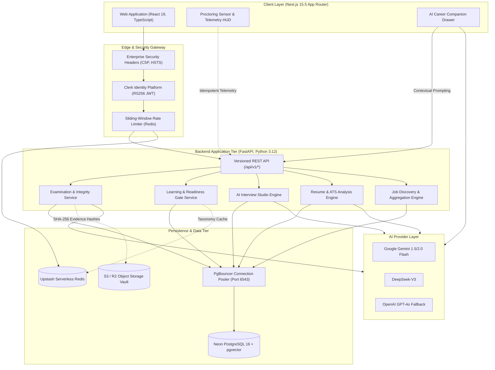

# UNNATI — Technical Architecture Reference

**Product:** UNNATI (उन्नति) — Your Growth Companion  
**Version:** 2.0.0-rc  
**Last Updated:** November 2026  
**Attribution:** Designed & Developed by Parth Ahuja  

---

## 1. Architecture Philosophy & Design Principles

UNNATI is designed as a modular, resilient, and privacy-first full-stack platform that unifies career exploration, resume intelligence, realistic interview preparation, skill assessment, and job matching.

The architecture adheres to four core tenets:
1. **Server-Authoritative Business Logic**: Critical computations (assessment scoring, examination timers, ATS calculations, and integrity evaluations) are executed exclusively on the backend to prevent client-side manipulation.
2. **Privacy-by-Design (DPDP Act, India 2026)**: User privacy is embedded into the data lifecycle. Proctoring operations persist structured telemetry and cryptographic hashes; no continuous uncompressed video or audio recordings are stored.
3. **Stateless Scalability**: The API tier is completely stateless, leveraging pooled PostgreSQL connections via PgBouncer, serverless Redis for sliding-window rate limiting, and asymmetric JWT token verification.
4. **Universal Offline & Online Testability**: The ORM layer supports native high-performance PostgreSQL types in production while compiling seamlessly to SQLite for local development and CI testing.

---

## 2. High-Level System Architecture

---

## 3. Subsystem Breakdown

### 3.1 Client Layer (`apps/web`)
- **Framework**: Next.js 15.5 with React 19 and App Router.
- **Styling**: Tailwind CSS v3.4, Lucide React icons, and Radix UI primitives.
- **Route Architecture**: 30 routes balancing static prerendering (`○`) for marketing, dashboard, and catalogs with dynamic server rendering (`ƒ`) for authenticated take rooms, interactive interviews, and certificate verification.
- **State & Suspense**: Client components utilize local hooks, debounced state transitions, and `<Suspense>` boundaries to prevent hydration mismatches.

### 3.2 Backend Service Tier (`apps/api`)
- **Framework**: FastAPI (Python 3.12) with ASGI asynchronous concurrency.
- **Schema Contracts**: Pydantic v2 schemas enforcing strict typing, `from_attributes=True`, and response filtering.
- **Authentication**: Asymmetric verification of Clerk session tokens using Clerk's JWKS endpoint with 5-second clock skew tolerance.
- **Role-Based Access Control**: Route-level dependency injection (`get_db_user`, `get_admin_user`) enforcing `student`, `proctor`, and `admin` permissions.

### 3.3 Persistence & Storage Tier
- **Database**: PostgreSQL 16 running on Neon Serverless compute with `pgvector` for resume and job description vector similarity search.
- **Connection Architecture**: Three distinct database identities (`unnati_owner` for DDL, `unnati_api` for transactional CRUD via PgBouncer, and `unnati_ro` for read-only analytics).
- **Cache**: Upstash Serverless Redis providing persistent token buckets for sliding-window rate limits and 24-hour taxonomy caching.
- **Object Vault**: S3-compatible cloud storage for secure document uploads and proctoring telemetry snapshots with automated 90-day retention policies.

---

## 4. Cross-Cutting Concerns

| Concern | Implementation Strategy |
| :--- | :--- |
| **Resilience & Idempotency** | Telemetry ingestion requires `client_event_id` with compound unique index `(attempt_id, client_event_id)` preventing duplicate records upon network retries. |
| **Tamper Proofing** | Certificate verification uses cryptographic SHA-256 hashes; proctoring evidence stores SHA-256 checksums to verify payload integrity. |
| **Rate Limiting** | Sliding window rate limits (60 req/min for IP, 120 req/min for authenticated user) guard against abusive polling and automated scrapers. |
| **Observability** | Structured logging, request correlation IDs, and automated health checks (`/api/v1/health`) monitor database and cache status. |
