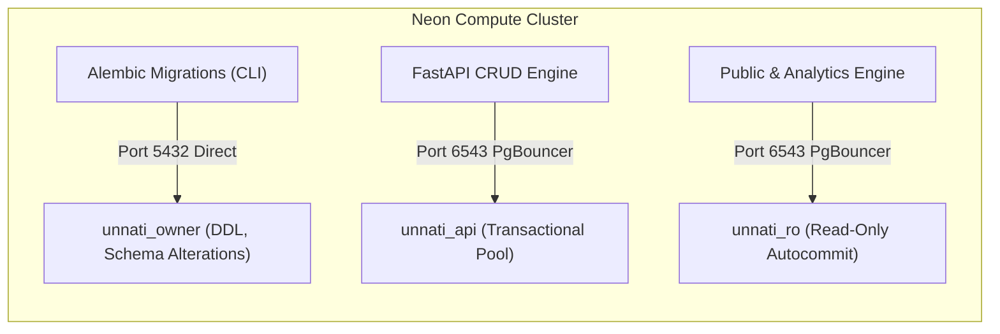

# UNNATI — Database Architecture & Persistence Reference

**Product:** UNNATI (उन्नति) — Your Growth Companion  
**Database Engine:** PostgreSQL 16 (Neon Serverless Compute)  
**Extensions:** `pgvector` (Vector Embeddings & Semantic Search)  
**ORM:** SQLAlchemy 2.0 (Declarative Mapping)  
**Last Updated:** November 2026  

---

## 1. Database Connection & Identity Architecture

UNNATI enforces strict segregation of database privileges using a three-identity architecture to adhere to the principle of least privilege:



1. **`unnati_owner`**: Direct connection on port 5432 used exclusively for executing schema migrations and administrative DDL operations.
2. **`unnati_api`**: Connection pool via PgBouncer on port 6543 configured with `pool_size=10`, `max_overflow=20`, `pool_pre_ping=True`, and session-scoped transactions.
3. **`unnati_ro`**: Read-only connection with `AUTOCOMMIT` isolation for high-frequency queries such as public certificate verification and catalog exploration.

---

## 2. Universal Schema Base Models

Every database model in UNNATI inherits from standard base mixins defined in `app/db/base.py`:

```python
class UUIDPrimaryKeyMixin:
    """Standard UUIDv4 primary key for all models."""
    id: Mapped[uuid.UUID] = mapped_column(
        UUID(as_uuid=True), primary_key=True, default=uuid.uuid4
    )

class TimestampMixin:
    """Automatic UTC timestamps for creation and modification tracking."""
    created_at: Mapped[datetime] = mapped_column(
        DateTime(timezone=True), server_default=func.now(), nullable=False
    )
    updated_at: Mapped[datetime] = mapped_column(
        DateTime(timezone=True), server_default=func.now(), onupdate=func.now(), nullable=False
    )
```

### Universal Dialect Compatibility (SQLite & PostgreSQL)
To enable zero-dependency local testing and CI pipeline execution without requiring a live PostgreSQL instance, `app/db/base.py` provides custom compiler hooks:
```python
@compiles(JSONB, "sqlite")
def compile_jsonb_sqlite(type_, compiler, **kw):
    return "JSON"

@compiles(ARRAY, "sqlite")
def compile_array_sqlite(type_, compiler, **kw):
    return "JSON"

@compiles(INET, "sqlite")
def compile_inet_sqlite(type_, compiler, **kw):
    return "VARCHAR(45)"
```
This guarantees that models using native PostgreSQL binary `JSONB` or `ARRAY` compile seamlessly to SQLite text columns during pytest runs, while retaining binary indexing in production.

---

## 3. Entity Catalog by Domain

### 3.1 Identity & User Domain (`app/models/user.py`)
- **`users`**: Root user entity synchronized with Clerk (`clerk_id`, `email`, `first_name`, `last_name`, `role`, `status`).
- **`user_profiles`**: Extended career metadata (`headline`, `summary`, `target_role`, `years_experience`, `city`, `country`).
- **`education_records`**: Formal academic history (`institution_name`, `degree`, `field_of_study`, `start_year`, `end_year`, `grade`).
- **`experience_records`**: Employment history (`company_name`, `job_title`, `employment_type`, `start_date`, `end_date`, `is_current`).

### 3.2 Skills & Learning Domain (`app/models/skill.py`, `app/models/learning.py`)
- **`canonical_skills`**: Standardized industry skill taxonomy (`id`, `name`, `category`, `domain`, `description`).
- **`candidate_skills`**: User-associated skills with mastery tiers (`BEGINNER`, `INTERMEDIATE`, `ADVANCED`, `EXPERT`) and verification badges.
- **`learning_resources`**: Curated free and paid courses (`title`, `provider`, `url`, `is_free`, `price_inr`, `difficulty`, `rating`, `duration_hours`).
- **`user_learning_progress`**: Candidate enrollment and milestone tracking (`SAVED`, `STARTED`, `IN_PROGRESS`, `COMPLETED`).
- **`assessment_readiness_logs`**: Audit of student readiness choice (`KNOW_TOPIC`, `NEED_TO_LEARN`, `WANT_DIAGNOSTIC`).

### 3.3 Examination & Proctoring Domain (`app/models/examination.py`)
- **`examinations`**: Assessment blueprints (`title`, `track`, `category`, `total_marks`, `passing_percentage`, `duration_minutes`, `proctoring_enabled`, `proctoring_config`).
- **`exam_questions`**: Questions (`question_type`, `prompt`, `scenario`, `code_snippet`, `options`, `marks`, `correct_answers`).
- **`exam_attempts`**: Session lifecycle (`attempt_number`, `status`, `score_obtained`, `expires_at`, `proctoring_consent`, `consent_timestamp`, `reviewer_decision`).
- **`exam_attempt_answers`**: Autosaved candidate inputs (`selected_options`, `text_response`, `is_marked_for_review`).
- **`exam_proctoring_events`**: Telemetry log (`event_type`, `severity`, `client_event_id`, `duration_seconds`, `confidence_score`, `metadata_payload`).
- **`proctoring_evidence`**: Evidence references (`storage_key`, `checksum_sha256`, `captured_at`, `retention_expires_at`, `access_classification`).
- **`proctoring_reviews`**: Human reviewer decisions (`reviewer_id`, `review_status`, `review_decision`, `reviewer_notes`, `reviewed_at`).
- **`proctoring_audit_logs`**: Immutable audit records (`actor_type`, `actor_id`, `action_type`, `target_type`, `previous_state`, `new_state`).
- **`exam_certificates`**: Verifiable credentials (`certificate_number`, `verification_hash`, `issue_date`).

### 3.4 Interview, Resume & Job Domains (`app/models/interview.py`, `app/models/resume.py`, `app/models/job.py`)
- **`interview_sessions`**: Mock interview instances (`role_target`, `interview_mode`, `overall_score`, `transcripts`, `rubric_scores`).
- **`resumes`**: ATS parsed documents (`file_url`, `ats_score`, `extracted_text`, `skills_extracted`, `section_scores`).
- **`jobs`**: Aggregated job listings (`title`, `company`, `location`, `salary_min`, `salary_max`, `required_skills`, `source_url`).

---

## 4. Compound Indexes for High Concurrency

The schema defines strategic composite indexes to ensure query times remain under 50ms:

```sql
-- Fast candidate attempt lookups
CREATE INDEX idx_exam_attempts_user_exam ON exam_attempts(user_id, examination_id, status);

-- Proctoring idempotency and timeline lookups
CREATE UNIQUE INDEX idx_proctoring_attempt_client_evt ON exam_proctoring_events(attempt_id, client_event_id);
CREATE INDEX idx_proctoring_attempt_timestamp ON exam_proctoring_events(attempt_id, timestamp);

-- Evidence & audit query lookups
CREATE INDEX idx_evidence_attempt_created ON proctoring_evidence(attempt_id, captured_at);
CREATE INDEX idx_audit_attempt_created ON proctoring_audit_logs(attempt_id, created_at);

-- Public certificate verification
CREATE UNIQUE INDEX idx_certificates_cert_num ON exam_certificates(certificate_number);
CREATE INDEX idx_certificates_verify_hash ON exam_certificates(verification_hash);
```

---

## 5. Migration Management with Alembic

Alembic manages all schema evolution. Migrations are executed against the direct compute port:
```bash
# Generate a new migration
alembic revision --autogenerate -m "add_proctoring_persistence"

# Apply migrations
alembic upgrade head

# Rollback one migration
alembic downgrade -1
```
