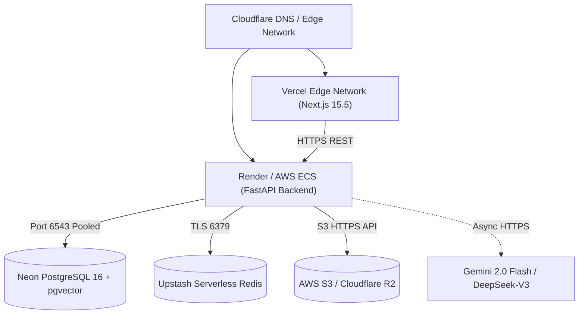

# UNNATI — Production Deployment & DevOps Guide

**Product:** UNNATI (उन्नति) — Your Growth Companion  
**Deployment Architectures:** Vercel (Frontend), Render / AWS ECS (Backend), Neon (Database), Upstash (Redis)  
**Last Updated:** November 2026  
**Attribution:** Designed & Developed by Parth Ahuja  

---

## 1. Cloud Architecture Overview



---

## 2. Frontend Deployment (Vercel)

### 2.1 Configuration
- **Framework Preset**: Next.js
- **Root Directory**: `apps/web`
- **Build Command**: `pnpm run build`
- **Output Directory**: `.next`
- **Install Command**: `pnpm install`

### 2.2 Environment Variables (Vercel Project Settings)
```ini
NEXT_PUBLIC_APP_URL=https://app.unnati.edu
NEXT_PUBLIC_API_BASE_URL=https://api.unnati.edu
NEXT_PUBLIC_CLERK_PUBLISHABLE_KEY=pk_live_...
NEXT_PUBLIC_CLERK_SIGN_IN_URL=/sign-in
NEXT_PUBLIC_CLERK_SIGN_UP_URL=/sign-up
NEXT_PUBLIC_CLERK_AFTER_SIGN_IN_URL=/dashboard
NEXT_PUBLIC_CLERK_AFTER_SIGN_UP_URL=/onboarding
```

### 2.3 Verification Command
```bash
cd apps/web
pnpm run build
pnpm run start
```

---

## 3. Backend Deployment (Render / AWS ECS / Docker)

### 3.1 Gunicorn + Uvicorn Production Launch Command
```bash
gunicorn app.main:app \
  --workers 4 \
  --worker-class uvicorn.workers.UvicornWorker \
  --bind 0.0.0.0:8000 \
  --access-logfile - \
  --error-logfile - \
  --timeout 120
```

### 3.2 Render Web Service Configuration (`render.yaml`)
```yaml
services:
  - type: web
    name: unnati-api
    env: python
    region: singapore
    plan: starter
    rootDir: apps/api
    buildCommand: pip install -r requirements.txt
    startCommand: gunicorn app.main:app --workers 4 --worker-class uvicorn.workers.UvicornWorker --bind 0.0.0.0:8000
    healthCheckPath: /api/v1/health
    envVars:
      - key: APP_ENV
        value: production
      - key: DEBUG
        value: false
      - key: DATABASE_URL
        sync: false
      - key: REDIS_URL
        sync: false
      - key: CLERK_SECRET_KEY
        sync: false
      - key: GEMINI_API_KEY
        sync: false
```

---

## 4. Database Setup & Migrations (Neon PostgreSQL)

### 4.1 Enable pgvector Extension
Connect via `psql` or Neon SQL console using `unnati_owner` and execute:
```sql
CREATE EXTENSION IF NOT EXISTS vector;
```

### 4.2 Apply Alembic Migrations
```bash
cd apps/api
alembic upgrade head
```

---

## 5. Pre-Release Verification Protocol

Before declaring any release live:
1. **Health Verification**:
   ```bash
   curl -I https://api.unnati.edu/api/v1/health
   # Expected: HTTP 200 OK with {"status": "healthy", "database": "connected", "redis": "connected"}
   ```
2. **CORS Verification**:
   ```bash
   curl -H "Origin: https://app.unnati.edu" -I https://api.unnati.edu/api/v1/health
   # Expected: Access-Control-Allow-Origin: https://app.unnati.edu
   ```
3. **Security Headers Verification**:
   ```bash
   curl -I https://app.unnati.edu
   # Expected: Strict-Transport-Security, X-Frame-Options: SAMEORIGIN, X-Content-Type-Options: nosniff
   ```
