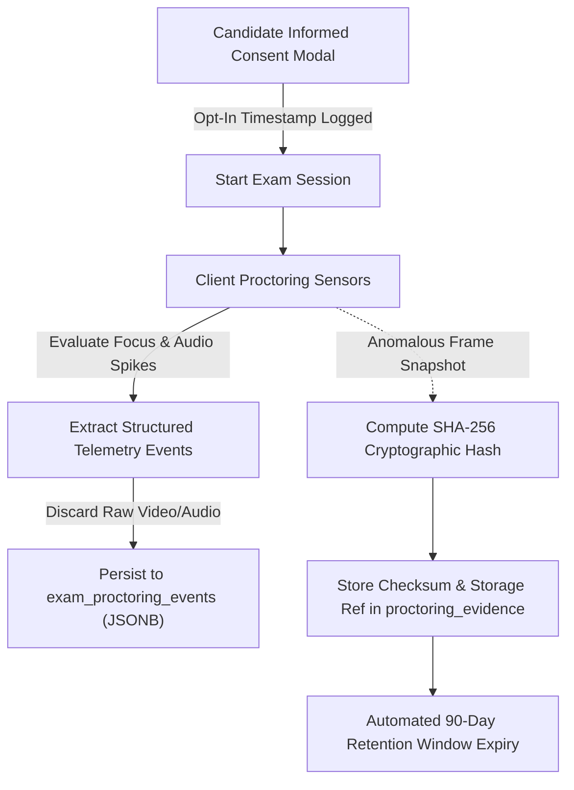

# UNNATI — Security & Privacy Architecture Reference

**Product:** UNNATI (उन्नति) — Your Growth Companion  
**Regulatory Standards:** Digital Personal Data Protection Act (DPDP Act, India 2026), OWASP API Security Top 10 (2023/2026), NIST SP 800-53  
**Last Updated:** November 2026  
**Attribution:** Designed & Developed by Parth Ahuja  

---

## 1. Executive Security Statement

UNNATI employs a defense-in-depth architecture across client, network, application, and persistence tiers. Security and user privacy are foundational requirements, not retrospective additions. The platform adheres strictly to the privacy-by-design principles mandated by the **Digital Personal Data Protection Act (India 2026)**.

---

## 2. Authentication & Identity Management

### 2.1 Clerk Cryptographic Asymmetric Verification
- User authentication is delegated to Clerk, operating as an OpenID Connect (OIDC) identity provider.
- All requests to protected API endpoints transmit an RS256-signed JWT token in the `Authorization: Bearer <token>` header.
- The FastAPI backend validates tokens offline using Clerk's public JSON Web Key Set (JWKS) cached in memory:
  ```python
  def decode_clerk_jwt(token: str) -> Dict[str, Any]:
      # Fetches public key from cached JWKS
      jwks_client = jwt.PyJWKClient(settings.clerk_jwks_url)
      signing_key = jwks_client.get_signing_key_from_jwt(token)
      payload = jwt.decode(
          token,
          signing_key.key,
          algorithms=["RS256"],
          audience=settings.clerk_audience,
          issuer=settings.clerk_issuer,
          leeway=settings.clerk_clock_skew_seconds # 5-second tolerance
      )
      return payload
  ```

### 2.2 Role-Based Access Control (RBAC)
User authorization operates under three distinct privilege tiers:
- **`student`**: Candidate tier; restricted to personal profiles, own examination attempts, own interview recordings, and public job/learning catalogs.
- **`proctor`**: Reviewer tier; authorized to inspect proctoring review queues, telemetry summaries, and record examination audit decisions.
- **`admin`**: System tier; authorized for institution dashboards, system analytics, and tenant management.

Every database query enforces tenant and ownership isolation:
```python
# Strict object-level ownership check
if attempt.user_id != user.id and user.role not in ["admin", "proctor"]:
    raise HTTPException(status_code=403, detail="Access denied: Not authorized to view this record.")
```

---

## 3. DPDP Act 2026 Privacy-by-Design Compliance



1. **Informed Consent Gate**: Examinations cannot commence without explicit opt-in (`proctoring_consent: true`). The exact UTC timestamp is recorded in `consent_timestamp`.
2. **Zero Continuous Raw Video/Audio Storage**: Continuous uncompressed video/audio is never retained. The system ingests only structured behavioral metrics (`TAB_SWITCH`, `MULTIPLE_FACES`, `NO_FACE_DETECTED`, `AUDIO_SPIKE`).
3. **Cryptographic SHA-256 Checksums**: In cases where anomalous snapshot frames are captured, the binary artifact's cryptographic SHA-256 hash is recorded in `proctoring_evidence.checksum_sha256`. Stored evidence cannot be altered undetected.
4. **Automated 90-Day Retention TTL**: Evidence rows specify `retention_expires_at` set automatically to 90 days from capture. Expired records are pruned by automated retention sweeps.
5. **Right to Erasure & Data Minimization**: Candidates retain the right to request deletion of personal telemetry. Anonymized statistical test scores are preserved for academic integrity.

---

## 4. HTTP Security Headers (Next.js Edge)

The frontend configuration (`apps/web/next.config.ts`) injects enterprise-grade security headers on every response:

```typescript
const securityHeaders = [
  { key: "X-DNS-Prefetch-Control", value: "on" },
  { key: "Strict-Transport-Security", value: "max-age=63072000; includeSubDomains; preload" },
  { key: "X-Frame-Options", value: "SAMEORIGIN" },
  { key: "X-Content-Type-Options", value: "nosniff" },
  { key: "Referrer-Policy", value: "strict-origin-when-cross-origin" },
  { key: "Permissions-Policy", value: "camera=(self), microphone=(self), geolocation=(), browsing-topics=()" },
  {
    key: "Content-Security-Policy",
    value: [
      "default-src 'self'",
      "script-src 'self' 'unsafe-inline' 'unsafe-eval' https://*.clerk.accounts.dev https://*.clerk.com",
      "style-src 'self' 'unsafe-inline' https://fonts.googleapis.com",
      "img-src 'self' data: blob: https://img.clerk.com https://images.unsplash.com",
      "font-src 'self' https://fonts.gstatic.com data:",
      "connect-src 'self' https://*.clerk.accounts.dev https://*.clerk.com https://unnati-connect-learning-capability-and.onrender.com http://localhost:8000 http://127.0.0.1:8000",
      "frame-src 'self' https://*.clerk.accounts.dev https://*.clerk.com",
      "worker-src 'self' blob:",
      "object-src 'none'",
      "base-uri 'self'",
      "form-action 'self'",
      "upgrade-insecure-requests"
    ].join("; ")
  }
];
```

---

## 5. Network Protection & Rate Limiting

- **Sliding-Window Limiter**: Powered by Upstash Serverless Redis to prevent brute-force attacks and resource exhaustion.
  - **Per IP**: Maximum 60 requests per minute.
  - **Per Authenticated User**: Maximum 120 requests per minute.
- **Fail-Open Resilience**: If Redis connectivity is temporarily interrupted, the rate-limiting middleware fails gracefully in-memory without rejecting legitimate student traffic.

---

## 6. Audit Trail & Non-Repudiation

All administrative actions (reviewing proctoring records, changing attempt outcomes, issuing certificates) write immutable log entries to `proctoring_audit_logs`:
- **Actor Identity**: `actor_type` (`CANDIDATE`, `PROCTOR`, `SYSTEM`) and `actor_id`.
- **Action Type**: E.g., `EVIDENCE_REGISTERED`, `REVIEW_RECORDED`, `STATUS_CHANGED`.
- **State Delta**: Records `previous_state` and `new_state` as JSONB payloads for complete forensic reconstruction.
